<p align="center">
  
</p>

<h1 align="center">Stepper-C</h1>

<p align="center">
  <b>Closed-loop microstepping current control for two-phase stepper motors, in portable C11 for any MCU.</b><br>
  No heap · No RTOS · MISRA C:2012 · 100 % line and branch coverage
</p>

<p align="center">
  <a href="https://github.com/AntonVynohradov/Stepper-C/actions/workflows/google-unit-tests.yml"></a>
  <a href="https://github.com/AntonVynohradov/Stepper-C/actions/workflows/static-analysis.yml"></a>
  <a href="https://github.com/AntonVynohradov/Stepper-C/actions/workflows/documentation.yml"></a>
  <a href="LICENSE"></a>
</p>

<p align="center">
  <a href="https://antonvynohradov.github.io/Stepper-C/">Documentation</a> ·
  <a href="https://antonvynohradov.github.io/Stepper-C/downloads/Stepper-C_User_Manual.pdf">PDF manual</a> ·
  <a href="https://antonvynohradov.github.io/Stepper-C/api/">API reference</a> ·
  <a href="CHANGELOG.md">Changelog</a>
</p>

---

## Overview

Stepper-C turns phase-current measurements and motion commands into PWM duty cycles for
a two-phase hybrid stepper motor. It regulates both phase currents with PI controllers at
the PWM rate, generates the microstep angle, plans trapezoidal moves and keeps the
voltage inside what the power stage can apply. The hardware (PWM, gate drivers, ADC) is
reached only through callbacks, so the same code runs on any MCU.

| | |
| --- | --- |
| **Current control** | PI per phase, gains derived from R, L and one bandwidth value; back-EMF feed-forward; anti-windup; bus voltage compensation; open-loop voltage mode for boards without current sensing |
| **Microstepping** | 1 to 256 microsteps per full step, 32-bit electrical angle, sine table with linear interpolation, angle interpolated at the PWM rate |
| **Motion** | Trapezoidal moves without overshoot, constant-velocity runs, stop, smooth retargeting, homing; exact integer positions |
| **Power stages** | Two H-bridges (4 legs) or three half-bridges with a shared leg (3 legs, for example B-G431B-ESC1) |
| **Protection** | Overcurrent, overvoltage, undervoltage, callback errors and external faults switch the outputs off in the same PWM period |
| **Numeric backends** | Fixed point (Q15/Q31, integer only) for cores without FPU, or single-precision float; selected at build time |

Measured on Cortex-M4 (GCC 15.2, `-Os`):

| | Fixed point | Float |
| --- | --- | --- |
| RAM per motor | 336 B | 360 B |
| Flash | 6980 B | 7446 B |
| Worst-case stack, fast loop / slow loop | 184 B / 140 B | 128 B / 132 B |

Closed loop on the motor model (17HS19-2004S1, 24 V, 20 kHz, 1 kHz current bandwidth):
a 2 A current step settles in 0.40 ms with 1.1 % overshoot; a 6400-microstep move ends on
the target with the rotor within 0.01 microstep.

## Project status

**Version 1.0.0**, the first release. The public API (`sstep.h` and `inc/`) is stable
within major version 1. The control loops are verified against a motor model in both
numeric backends and both topologies.

- [x] Current control, microstepping, motion planner, protection, both backends
- [x] Unit and closed-loop tests with 100 % coverage; MISRA C:2012 with 0 violations
- [x] Documentation website and PDF manual
- [ ] Software-in-the-loop against the Scilab/Xcos motor model
- [ ] Port and measurements on STMicroelectronics B-G431B-ESC1 (fast-loop execution time)
- [ ] Dead-time compensation (`dead_time_ns` is reserved in the configuration)

## Quick start

```c
#include "sstep.h"

static struct sstep motor;               /* 336 B on Cortex-M4, owned by the application */

void ADC1_2_IRQHandler(void)             /* PWM/ADC interrupt, 20 kHz */
{
    const struct sstep_sample s = {board_adc_phase_a(), board_adc_phase_b(), board_adc_vbus()};
    (void)sstep_fast_loop(&motor, &s);
}

int main(void)
{
    board_init();
    (void)sstep_init(&motor, &motor_config); /* motor, power stage, control, callbacks */
    (void)sstep_enable(&motor);
    (void)sstep_move_to(&motor, 3200);       /* one revolution at 16 microsteps */
    for (;;)
    {
        if (board_tick_1ms())
        {
            (void)sstep_slow_loop(&motor);
        }
    }
}
```

The complete program with the configuration of a 17HS19-2004S1 on a B-G431B-ESC1 is on
the [documentation home page](https://antonvynohradov.github.io/Stepper-C/).

## Building

Requirements: a C11 compiler and CMake 3.20 or later. GoogleTest and gcovr for the tests,
Cppcheck for the MISRA check, Python 3 for the documentation.

| Preset | Purpose |
| --- | --- |
| `[Debug]Stepper Motor Control` | Static library with debug information |
| `[Release]Stepper Motor Control` | Optimized static library |
| `[UnitTests]Stepper Motor Control` | Unit and closed-loop tests, fixed point, coverage gate |
| `[UnitTestsFloat]Stepper Motor Control` | The same tests with the float backend |

```bash
cmake --preset "[Release]Stepper Motor Control"
cmake --build "build/[Release]Stepper Motor Control"

cmake --preset "[UnitTests]Stepper Motor Control"
cmake --build "build/[UnitTests]Stepper Motor Control" --target coverage

cmake --build "build/[Debug]Stepper Motor Control" --target misra-analyze
```

**In your CMake project:**

```cmake
set(SSTEP_MATH_BACKEND FLOAT)                 # MCU with FPU; default FIXED
include(path/to/Stepper-C/sstep.cmake)
target_link_libraries(app PRIVATE sstep)
```

**Any other build system:** compile `src/*.c`, add the repository root and `inc/` to the
include path.

| CMake option | Default | Meaning |
| --- | --- | --- |
| `SSTEP_MATH_BACKEND` | `FIXED` | Numeric backend: `FIXED` or `FLOAT` |
| `SSTEP_CONFIG_DIR` | empty | Folder with `sstep_user_config.h` (build-time options) |
| `SSTEP_UNIT_TESTS` | `OFF` | GoogleTest suite and `coverage` target |

## Project structure

```text
sstep.h                 public API: all functions, version
inc/                    public types: configuration, status, codes, build-time options
src/                    private implementation
  sstep_ctrl.c          control, state machine, fast and slow loop
  sstep_motion.c        trapezoidal motion planner
  sstep_bridge.c        voltage limit and duty cycles per topology
  sstep_math.[ch]       numeric backend (fixed point or float)
  sstep_sin_table.c     generated sine table
tests/unit/             GoogleTest unit tests and closed-loop tests on a motor model
cmake/                  version, unit tests, MISRA check
docs/                   documentation website and PDF manual sources
tools/                  sine table generator, documentation tools
```

## Documentation

The website at **[antonvynohradov.github.io/Stepper-C](https://antonvynohradov.github.io/Stepper-C/)**
covers the architecture, the control algorithms with measured results, integration on
an MCU, configuration, the measured stack and memory footprint, the API and the MISRA
compliance. The same content is available as a printable PDF manual.

```bash
python -m pip install -r requirements-dev.txt
mkdocs serve                                  # live preview
python tools/docs/build_manual.py             # PDF manual
python tools/docs/diagrams.py                 # regenerate the diagrams
python tools/docs/check_snippets.py           # compile every code snippet of the docs
```

## Author

**Anton Vynohradov** — Embedded Systems Engineer, Secure Product Architect, founder of
SystemFromScratch®.
[systemfromscratch.com](https://systemfromscratch.com) ·
[GitHub](https://github.com/AntonVynohradov) ·
[LinkedIn](https://www.linkedin.com/in/vynohradov) ·
[ORCID](https://orcid.org/0009-0005-6965-0911) ·
avynohradov@systemfromscratch.com

## Releases and versioning

[Semantic Versioning](https://semver.org); the version comes from the `vX.Y.Z` Git tag.
Every change is recorded in [CHANGELOG.md](CHANGELOG.md). Each
[release](https://github.com/AntonVynohradov/Stepper-C/releases) provides the source, a
prebuilt static library for Linux x86-64 (fixed-point backend, default options) with its
headers, the MISRA report and the PDF manual. For an MCU, build the library from source
with your toolchain and options.

## Contributing

Issues and pull requests are welcome. A change must keep the library warning-free, pass
the unit tests of both numeric backends with 100 % line and branch coverage, pass
`misra-analyze` with 0 violations and keep the documentation in sync. See
[Extending the Library](https://antonvynohradov.github.io/Stepper-C/extending/).

## License

Copyright © 2026 Anton Vynohradov. Licensed under the [Apache License 2.0](LICENSE).

SystemFromScratch® is a registered trademark. The Apache License 2.0 grants no rights to
use the SystemFromScratch® name or logo; they may not be used to endorse or promote
products derived from Stepper-C without prior written permission. STM32 is a registered
trademark of STMicroelectronics International N.V.; Stepper-C is not affiliated with or
endorsed by STMicroelectronics.

## References

- [Documentation](https://antonvynohradov.github.io/Stepper-C/) and
  [PDF manual](https://antonvynohradov.github.io/Stepper-C/downloads/Stepper-C_User_Manual.pdf)
- [MISRA C:2012](https://misra.org.uk/) — coding guidelines
- [Keep a Changelog](https://keepachangelog.com/) and [Semantic Versioning](https://semver.org/)
