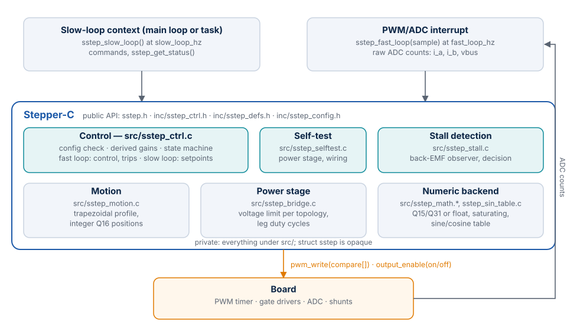
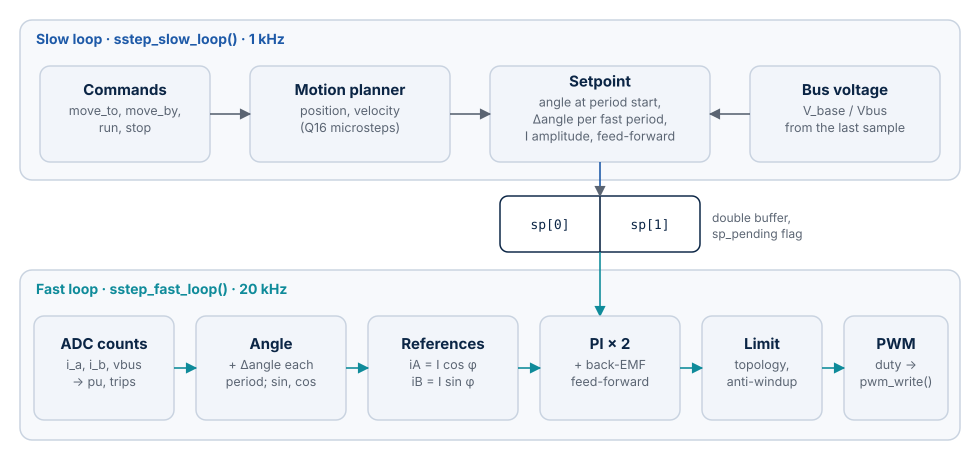
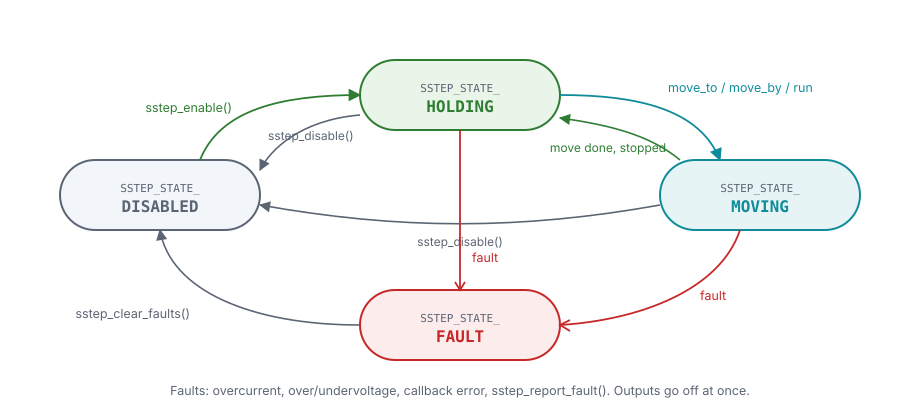

# How It Works

This chapter explains how Stepper-C is built: its modules, the two loops and how they
exchange data, the driver states, the memory model, error handling and the rules for
calling it from interrupts. The control algorithms themselves (current control,
microstepping, trajectory, voltage limits) are described in [Motor Control](motor-control.md).

## Modules

| Module | Files | Responsibility |
| --- | --- | --- |
| Public API | `sstep.h`, `inc/sstep_ctrl.h`, `inc/sstep_defs.h`, `inc/sstep_config.h` | Functions, configuration and status types, status codes, fault flags, build-time options |
| Control | `src/sstep_ctrl.c` | Configuration check, derived constants, fast loop (current control, protection, PWM), slow loop (setpoints, hold current, events), commands, state machine |
| Self-test | `src/sstep_selftest.c` | Power stage and wiring test before the first enable, one step per fast loop period (`SSTEP_CFG_SELFTEST`) |
| Stall detection | `src/sstep_stall.c` | Back-EMF observer (fast loop), stall decision (slow loop), estimates of the status |
| Motion | `src/sstep_motion.c` | Trapezoidal trajectory in integer arithmetic (both backends) |
| Power stage | `src/sstep_bridge.c` | Voltage limit of the topology, phase voltages to leg compare values |
| Numeric backend | `src/sstep_math.h`, `src/sstep_math.c`, `src/sstep_sin_table.c` | Saturating Q15/Q31 or float operations, gains, sine/cosine table |

Only the public API is visible to the application. Everything under `src/` is private:
the driver instance `struct sstep` is an opaque block of memory whose layout may change
in any release.

## The two loops

The application calls two functions periodically. Both work on the same instance.

| | Fast loop `sstep_fast_loop()` | Slow loop `sstep_slow_loop()` |
| --- | --- | --- |
| Rate | `fast_loop_hz`, typically the PWM frequency (20 kHz) | `slow_loop_hz`, typically 1 kHz; `fast_loop_hz` must be an integer multiple |
| Context | PWM/ADC interrupt | Main loop or a timer task |
| Input | Raw ADC counts: phase A and B currents, bus voltage | Commands given since the last call |
| Work | Convert the measurements, check the trip levels, interpolate the electrical angle, current references, PI controllers, voltage limit, leg duty cycles; back-EMF observer (stall detection) | Advance the trajectory one step, compute the setpoint of the next slow period, hold current, bus voltage compensation, state, events, stall decision |
| Output | `pwm_write()` with one compare value per leg | A setpoint for the fast loop; `on_event()` |
| Time | Bounded: no loops over data; the only loops have fixed limits (voltage pre-scale at most 18, division at most 16 iterations); two divisions, only while the voltage is limited | Bounded: integer square root at most 32 iterations; one gain computation for the bus voltage |

**Hand-off.** The slow loop computes a *setpoint* for the next slow period: the
electrical angle at its start, the angle increment per fast period, the current
amplitude, the back-EMF feed-forward and the bus voltage correction. It writes it into
the free half of a double buffer and marks it pending. The fast loop takes a pending
setpoint at the start of its next period and from then on advances the angle by the
increment once per period. If the slow loop is late, the fast loop stops advancing after
`fast_loop_hz / slow_loop_hz` periods and holds the angle, so a late slow loop never
makes the motor run ahead of the trajectory.

The fast loop never reads the half being written: `sp_pending` is cleared before the
write and set after it. This relies on the fast loop interrupting the slow loop on the
same core, never running in parallel with it.

## Driver states

| State | Outputs | Entered by | Left by |
| --- | --- | --- | --- |
| `SSTEP_STATE_DISABLED` | Off (all legs high impedance) | `sstep_init()`, `sstep_disable()`, `sstep_clear_faults()` | `sstep_enable()` |
| `SSTEP_STATE_HOLDING` | On, holding the position | `sstep_enable()`; a move or stop completes | A command; a fault; `sstep_disable()` |
| `SSTEP_STATE_MOVING` | On, following the trajectory | `sstep_move_to()`, `sstep_move_by()`, `sstep_run()` (seen at the next slow loop) | Move or stop completes; a fault; `sstep_disable()` |
| `SSTEP_STATE_FAULT` | Off | Any fault, in any active state | `sstep_clear_faults()` only |

The state is updated by the slow loop; a command changes it at the next
`sstep_slow_loop()`. Faults switch the outputs off immediately, in the context that
detects them.

## Memory model

| Object | Owner | Size | Lifetime |
| --- | --- | --- | --- |
| `struct sstep` (driver instance) | Application (static, stack or pool) | 488 B fixed point, 520 B float on Cortex-M4 | From `sstep_init()` as long as the motor runs |
| `struct sstep_config` | Application; copied by `sstep_init()` | 156 B on Cortex-M4 | Only during `sstep_init()` |
| `struct sstep_sample` | Application | 6 B | Only during `sstep_fast_loop()` |
| `struct sstep_status` | Application | 48 B on Cortex-M4 | Filled by `sstep_get_status()` |
| Sine table | Library, `static const` (flash) | 514 B fixed point, 1028 B float (default 257 entries) | Program |

There is no heap, no global or static mutable variable and no hidden buffer: everything
the library writes is in the instance or in the caller's structures. Several instances
(axes) are independent.

The instance size is fixed at compile time by `SSTEP_INSTANCE_WORDS` in `sstep_ctrl.h`
(from `SSTEP_CONFIG_BYTES` and `SSTEP_STATE_BYTES`, plain constants so that static
analysis can evaluate them) and checked against the private state by `_Static_assert`.

## Error handling

| Situation | Result |
| --- | --- |
| `NULL` instance, configuration or sample | `SSTEP_ERR_PARAM`; nothing is changed |
| A configuration field outside its range or a missing required callback | `sstep_init()` returns `SSTEP_ERR_PARAM` |
| Fields that are valid alone but not together (trip above full scale, bandwidth above `fast_loop_hz / 4`, a gain that does not fit) | `sstep_init()` returns `SSTEP_ERR_CONFIG` |
| A topology that is not compiled in | `sstep_init()` returns `SSTEP_ERR_UNSUPPORTED` |
| `sstep_selftest()` built with `SSTEP_CFG_SELFTEST = 0` | Returns `SSTEP_ERR_UNSUPPORTED` |
| Any call before a successful `sstep_init()` (zeroed instance, or the last `sstep_init()` failed in the derivation) | `SSTEP_ERR_STATE`; no callback is called |
| A motion command while disabled or faulted | `SSTEP_ERR_STATE` |
| A phase current above `i_trip_ma` (current drive) | `SSTEP_FAULT_OVERCURRENT`, outputs off in the same fast period |
| Bus voltage above `vbus_max_mv` or below `vbus_min_mv` | `SSTEP_FAULT_OVERVOLTAGE` / `SSTEP_FAULT_UNDERVOLTAGE`, outputs off |
| `pwm_write()` or `output_enable()` returns a negative value | `SSTEP_FAULT_HAL`, outputs off |
| The rotor does not follow the commanded angle for `stall_time_ms` (stall detection on) | `SSTEP_FAULT_STALL`, outputs off in the slow loop |
| `sstep_report_fault()` | The given flags, outputs off |

Every fault calls `output_enable(false)` and then `on_fault()` (if set) with the new
flags, in the context that detected it. Faults accumulate until `sstep_clear_faults()`.
Arithmetic never overflows: every operation of the numeric backend saturates.

## Threading and reentrancy

- **Per instance, two contexts:** `sstep_fast_loop()` from the PWM/ADC interrupt;
  every other function from one task or the main loop (the slow-loop context).
- `sstep_report_fault()` may also be called from an interrupt.
- **No locking inside.** The hand-off between the loops is lock-free on a single core
  (see above). Do not call the slow-loop functions from two tasks without your own mutex.
- **Multi-core:** both loops of one instance must run on the same core.
- **Different instances** share nothing and may run on different cores.
- **Callbacks** run in the context of the function that calls them: `pwm_write()` and
  `on_fault()` may run in the interrupt.

## Design decisions

| Decision | Reason |
| --- | --- |
| Two loops at different rates | Current control needs the PWM rate; the trajectory and the square root of the motion planner do not. The fast loop stays short and bounded. |
| Configuration in integer engineering units | Values from the datasheet and the schematic are entered as they are (`r_mohm = 1600`); no floating point is needed to configure a fixed-point build. |
| Gains derived by the library | Kp and Ki follow from R, L and one bandwidth value; there is nothing to tune by hand for a first run. |
| Fixed point and float backends with the same ranges | The same code and the same tests run on MCUs with and without FPU; the results match within the quantization. |
| Motion planner in integer arithmetic in both backends | Positions must be exact over long runs; Q16 microsteps in 64 bits never drift. |
| Callbacks given once at initialization | No link-time coupling to a HAL; several instances can drive different timers. |
| Raw ADC counts as input | The library owns the scaling (zero offset, span, polarity) and the trip levels in counts, so the protection does not depend on a conversion done elsewhere. |
| Opaque instance | The application cannot depend on internal fields; the layout can change without breaking the API (MISRA deviation [DEV-01](misra.md#dev-01-rule-113-required-opaque-driver-instance)). |
