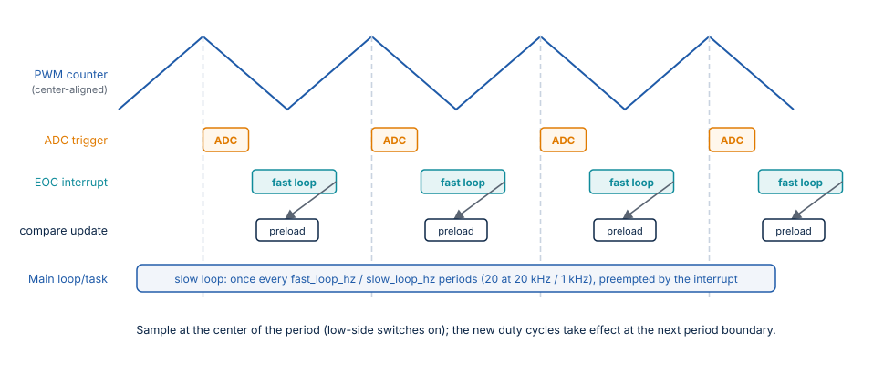

# Integration Guide

Stepper-C does not touch hardware. An integration has four parts:

1. **PWM:** a timer with one compare channel per leg, loaded by `pwm_write()`.
2. **Measurement:** ADC conversions of the two phase currents and the bus voltage,
   synchronized to the PWM, passed to `sstep_fast_loop()` as raw counts.
3. **Fast loop interrupt:** at the end of each conversion sequence, call
   `sstep_fast_loop()`.
4. **Slow loop:** call `sstep_slow_loop()` and the commands from one task or the main
   loop at `slow_loop_hz`.



## PWM

- Use **center-aligned** PWM with the period `pwm_period_ticks`; one compare value per
  leg, in the order of the topology: full bridge `[A+ A− B+ B−]`, shared leg `[U V W]`.
  A compare value of `pwm_period_ticks` means the high-side switch is on for the whole
  period.
- Load the compare values with **preload** (shadow registers) so that `pwm_write()`
  takes effect at the next period boundary, not in the middle of a period.
- Dead time is inserted by the timer or the gate driver; the library does not
  compensate it in this version.
- `output_enable(false)` must put **every** leg in high impedance (for example the
  timer's main output enable bit and the gate drivers' enable pins), not only set
  50 % duty.

## Current and voltage measurement

- Trigger the ADC from the PWM timer at the **center of the period**, where the low-side
  switches conduct and the switching noise is furthest away; with low-side shunts this is
  the only point where the current is visible.
- Convert phase A, phase B and the bus voltage in one sequence, and call
  `sstep_fast_loop()` from its end-of-conversion interrupt.
- In the shared-leg topology the two measured currents are the phase currents A and B;
  the shared leg carries their sum.
- Measure `adc_i_zero` with the outputs off after power-up; the library uses the value
  from the configuration, so re-initialize with the measured value if it differs from the
  default.

## Timing

| Item | Requirement |
| --- | --- |
| `fast_loop_hz` | The real rate of the end-of-conversion interrupt; usually the PWM frequency or a fraction of it (every second period at 40 kHz PWM) |
| `slow_loop_hz` | The real rate of `sstep_slow_loop()`; `fast_loop_hz` must be a multiple of it |
| Jitter of the slow loop | Tolerated: the fast loop holds the angle if the slow loop is late, and catches up with the next setpoint |
| Priority | The fast-loop interrupt preempts the slow-loop context, never the other way round |
| Execution time of the fast loop | Must end well before the next conversion; measure it on your MCU (toggle a pin or read the cycle counter) |

The library measures nothing about time: if the configured rates do not match the real
ones, the velocities, the accelerations and the hold delay scale accordingly.

## Bare metal

```c
int main(void)
{
    board_init(); /* clocks, PWM timer, ADC triggered by the timer, interrupts */
    if ((sstep_init(&motor, &motor_config) != SSTEP_OK) || (sstep_enable(&motor) != SSTEP_OK))
    {
        for (;;)
        {
        }
    }
    for (;;)
    {
        if (board_tick_1ms()) /* set by SysTick or a timer */
        {
            (void)sstep_slow_loop(&motor);
            /* commands and the application's state machine here */
        }
    }
}
```

## RTOS

Run the slow loop in a periodic task with a fixed period (not a delay after the work),
and call every command from that task, or from another task through a queue:

```c
#include "FreeRTOS.h"
#include "task.h"

static void motor_task(void* arg)
{
    TickType_t wake = xTaskGetTickCount();
    (void)arg;
    for (;;)
    {
        vTaskDelayUntil(&wake, pdMS_TO_TICKS(1));
        (void)sstep_slow_loop(&motor);
        /* take commands from a queue and call sstep_move_to() etc. here */
    }
}
```

The fast loop stays in the ADC interrupt; give it a priority above the RTOS kernel's
interrupt priority limit only if it calls no RTOS function (the library calls none; check
your callbacks).

## Adding the library to a CMake build

```cmake
set(SSTEP_MATH_BACKEND FLOAT)                         # MCU with FPU; default FIXED
include(path/to/Stepper-C/sstep.cmake)
target_link_libraries(app PRIVATE sstep)
target_link_libraries(sstep PUBLIC zephyr_interface)  # Zephyr applications only
```

The backend and the other build-time options are compile definitions of the `sstep`
target, so the application sees the same values as the library.

**Without CMake:** compile `src/*.c`, add the repository root and `inc/` to the include
path, and pass the same `-DSSTEP_CFG_…` definitions to the library and the application.

## Bring-up checklist

1. **Outputs off:** read the ADC and check `adc_i_zero` and the bus voltage reading
   against a multimeter (`sstep_get_status()` shows `vbus_mv` after a fast loop). With
   low-side shunts, set `sample_window_ticks` so that every conversion of the fast loop
   falls into the time all legs are on their low-side switch
   ([Sampling window](motor-control.md#sampling-window)): without it a duty cycle near
   100 % corrupts the samples, and a false undervoltage or overcurrent trip follows.
2. **Polarity:** start with `drive_mode = SSTEP_DRIVE_VOLTAGE` and a small `i_run_ma`;
   after `sstep_enable()`, the measured current of phase A must be positive and close to
   the reference. If it is negative, negate `adc_i_span`.
3. **Current loop:** switch to `SSTEP_DRIVE_CURRENT` with a low run current; look at the
   phase current with a current probe or the status: it must settle at `i_run_ma`.
4. **Motion:** run slowly (`sstep_run()` with a few hundred microsteps/s), then raise the
   speed and the acceleration to the application's values.
5. **Protection:** run `sstep_selftest()` before the first enable, check the trips with a
   lowered `i_trip_ma` and `vbus_max_mv`, and the external fault input with
   `sstep_report_fault()` ([Protection](protection.md)).
6. **Stall detection (optional):** enable it with the example values, log
   `stall_level_pct`, `emf_d_mv` and `load_angle_cdeg` through every operating point
   (enable, hold, the fastest move, the heaviest load), then block the shaft by hand at
   speed and at standstill to see `SSTEP_FAULT_STALL`
   ([choosing the parameters](motor-control.md#choosing-the-parameters)).
