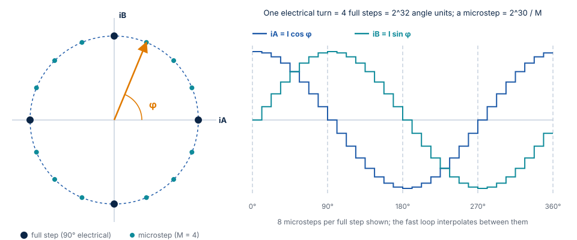
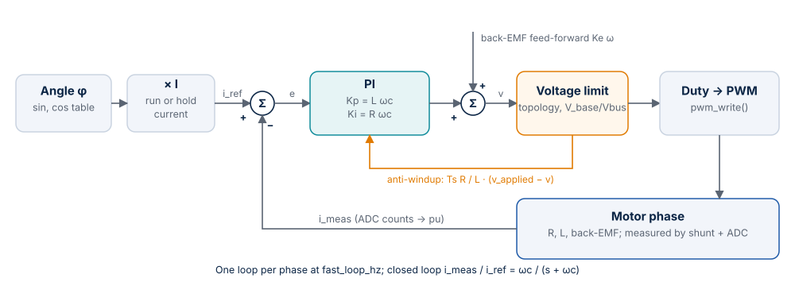
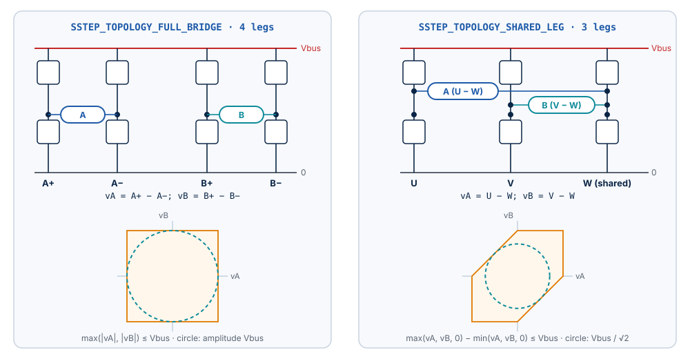
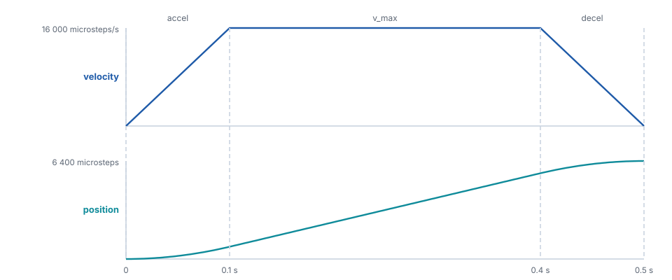

# Motor Control

This chapter describes the algorithms of Stepper-C and the equations behind them: the
motor model, per-unit scaling, the current controller, microstepping, the motion
profile, the voltage limits of the two power stage topologies, the stall detection and
the numeric backends.
Every number in this chapter comes from the code or from the closed-loop tests on the
motor model (`tests/unit/gtest_sstep_loop.cpp`).

## Motor model

A two-phase hybrid stepper motor with $N_s$ full steps per revolution has $p = N_s / 4$
pole pairs (50 for a 1.8° motor). With the rotor angle $\theta$ and its speed $\omega$, each phase is
a resistance, an inductance and a back-EMF:

$$
\begin{aligned}
v_A &= R\,i_A + L\,\frac{di_A}{dt} - K_t\,\omega \sin(p\theta) \\
v_B &= R\,i_B + L\,\frac{di_B}{dt} + K_t\,\omega \cos(p\theta) \\
T_e &= K_t \left( i_B \cos(p\theta) - i_A \sin(p\theta) \right)
\end{aligned}
$$

$K_t$ is the torque constant [N·m/A]; in SI units it equals the back-EMF constant
[V·s/rad], the value entered as `ke_uv_s_per_rad`.

The library imposes the phase currents

$$
i_A = I \cos\varphi \qquad i_B = I \sin\varphi
$$

where $\varphi$ is the electrical angle commanded by the trajectory. The torque becomes

$$
T_e = K_t\, I \sin(\varphi - p\theta)
$$

The rotor follows $\varphi$ with a lag (the *load angle*) that grows
with the load. The motor holds up to $K_t I$ (0.42 N·m for 2 A with the 17HS19-2004S1)
at a load angle of 90° and loses steps above it.

The closed-loop test with a 0.25 N·m load at 1 rev/s measures a load angle of 37.21°,
against $\arcsin(0.25 / 0.4172) = 36.83°$ predicted by the equation; with 0.50 N·m the
motor slips, as expected.

## Per-unit scaling

Internally every signal is a fraction of a base value, so that the same arithmetic
works for a 0.5 A and a 10 A motor:

| Quantity | Base | Range inside the loops |
| --- | --- | --- |
| Current | `i_full_scale_ma`: the current at ADC full scale | -1 .. +1 pu |
| Voltage | `vbus_nominal_mv`: the nominal bus voltage | -1 .. +1 pu for signals; up to ±65 536 pu in accumulators |
| Bus voltage | `vbus_nominal_mv` | 0 .. 2 pu |
| Angle | One electrical turn = $2^{32}$ | `uint32_t`, wraps |

`sstep_init()` converts every engineering value of the configuration into per-unit
gains with integer arithmetic ($2\pi \approx 710 / 113$, error $8.5 \cdot 10^{-8}$), so a fixed-point
build needs no floating point at all.

## Microstepping

One full step is a quarter of an electrical turn ($2^{30}$). With `microsteps` $= M$, one
microstep is $2^{30} / M$ of the 32-bit angle; positions are kept in Q16 microsteps
(1/65 536 microstep) in 64 bits, so the angle is exact and never drifts.

The sine and cosine come from a quarter-wave table with linear interpolation
(`SSTEP_CFG_SINE_TABLE_BITS`, default $2^8$ intervals, 257 entries in flash). Measured
worst-case error over a full turn:

| Table bits | Fixed point | Float |
| --- | --- | --- |
| 6 | $1.08 \cdot 10^{-4}$ (3.5 LSB of Q15) | $7.5 \cdot 10^{-5}$ |
| 8 (default) | $3.1 \cdot 10^{-5}$ (1.0 LSB of Q15) | $4.8 \cdot 10^{-6}$ |
| 10 | $3.1 \cdot 10^{-5}$ (1.0 LSB of Q15) | $3.5 \cdot 10^{-7}$ |

With the fixed-point backend the default table is already at the resolution of Q15;
a larger table only helps the float backend.

Between two slow-loop periods the fast loop advances the angle by a constant increment,
so the current vector turns smoothly at the PWM rate instead of jumping once per
millisecond.

## Current control

Each phase has its own PI controller. The reference comes from the angle and the
amplitude, the measurement from the ADC:

$$
e = i_\mathrm{ref} - i_\mathrm{meas} \qquad
v = K_p\, e + K_i \int e\, dt + v_\mathrm{ff}
$$

**Gains.** `sstep_init()` places the zero of the controller on the pole of the winding
($R / L$), which leaves an integrator with the crossover frequency
$\omega_c = 2\pi \cdot$ `current_bw_hz`:

$$
K_p = L\,\omega_c \qquad K_i = R\,\omega_c \qquad\Longrightarrow\qquad
\frac{i_\mathrm{meas}}{i_\mathrm{ref}} = \frac{\omega_c}{s + \omega_c}
$$

The closed loop is a first-order low-pass with the requested bandwidth; no manual
tuning is needed. The bandwidth must not exceed `fast_loop_hz / 4` (checked by
`sstep_init()`).

**Back-EMF feed-forward.** At speed the motor generates a voltage that the PI would
otherwise have to compensate with an error. The library adds it in advance from the
commanded speed:

$$
v_{A,\mathrm{ff}} = -K_e\,\omega \sin\varphi \qquad
v_{B,\mathrm{ff}} = K_e\,\omega \cos\varphi \qquad
\omega = \frac{2\pi\, v}{N_s M}
$$

with $v$ in microsteps/s. With `ke_uv_s_per_rad = 0` the feed-forward is off.

**Anti-windup.** When the requested voltage exceeds what the power stage can apply
(see [Voltage limits](#voltage-limits)), the integrator is corrected by the difference
between the applied and the requested voltage (back-calculation with the tracking time
constant $T_t = L / R$, gain $T_s R / L$). The integrator does not wind up while the voltage
is limited.

**Measured response** (17HS19-2004S1, 24 V, 20 kHz, 1 kHz bandwidth, locked rotor, step
0 → 2 A, ADC 12 bits):

| Topology | Overshoot | Rise time 0–90 % | Settling ±2 % | Final value |
| --- | --- | --- | --- | --- |
| Full bridge | 1.11 % | 0.350 ms | 0.400 ms | 2.0002 A |
| Shared leg | 1.11 % | 0.350 ms | 0.400 ms | 1.9999 A |

The float backend gives the same numbers within 0.01 %. A first-order system with
1 kHz bandwidth rises to 90 % in $2.3 / \omega_c = 0.37$ ms; the small overshoot comes from the
one-period delay between measurement and PWM update.

### Voltage drive

Boards without current sensing use `SSTEP_DRIVE_VOLTAGE`: the controller is replaced
by $v = R\, i_\mathrm{ref} + v_\mathrm{ff}$. The current settles at the reference at standstill (test:
2.0 A within 10 mA) but the torque drops at speed, where the inductance and the
error of the back-EMF estimate are not corrected. The overcurrent trip is not active in
this mode (there is no current measurement).

## Bus voltage compensation

The controllers compute voltages in per unit of the *nominal* bus voltage. The fast loop
converts them to duty cycles with the *measured* bus voltage ($V_\mathrm{base} / V_\mathrm{bus}$, updated
every slow period), so the phase voltage, and with it the current, does not depend on
the supply. Test: with the supply at half its nominal value, the current still settles
at 2.0 A within 4 mA.

## Voltage limits

The two supported topologies differ in how much phase voltage they can apply:

| Topology | Legs | Phase voltages | Limit (relative to Vbus) | Sinusoidal amplitude |
| --- | --- | --- | --- | --- |
| `SSTEP_TOPOLOGY_FULL_BRIDGE` | 4: A+, A−, B+, B− | $v_A = A^+ - A^-$, $v_B = B^+ - B^-$ | $\max(\lvert v_A \rvert, \lvert v_B \rvert) \le 1$ | $V_\mathrm{bus}$ |
| `SSTEP_TOPOLOGY_SHARED_LEG` | 3: U, V, W (shared) | $v_A = U - W$, $v_B = V - W$ | $\max(v_A, v_B, 0) - \min(v_A, v_B, 0) \le 1$ | about $V_\mathrm{bus} / \sqrt{2}$ |

When the request is beyond the limit, both phase voltages are scaled down by the same
factor: the direction of the voltage vector is kept, only its length is reduced, and the
anti-windup takes the difference into account.

**Duty cycles.** Full bridge: each phase is centred at 50 %. Shared leg: the shared leg
W is placed in the middle of the available range:

$$
A^{\pm} = \frac{1}{2} \pm \frac{v_A}{2}, \quad B^{\pm} = \frac{1}{2} \pm \frac{v_B}{2}
\qquad\qquad
W = \frac{1}{2} - \frac{\max(v_A, v_B, 0) + \min(v_A, v_B, 0)}{2}, \quad
U = v_A + W, \quad V = v_B + W
$$

The fourth compare value is 0 for the shared leg.

**Consequence at speed.** At 8 rev/s (2 A requested, 24 V) the measured current
amplitude is 1.862 A with a full bridge and 1.557 A with a shared leg: the three-leg
stage reaches its voltage limit first. Choose the supply voltage for the highest speed
of the application.

### Sampling window

Low-side shunts carry the phase current only while the low-side switch of their leg
conducts. With a duty cycle near 100 % that time shrinks to nothing: the edges and the dead
time fall into the conversion, and a single wrong sample of the current or of the bus
voltage (an undervoltage trip) follows. `sample_window_ticks` ($W$) keeps every compare
value at or below $P - W$ ($P$ = `pwm_period_ticks`), so every leg spends at least $W$ ticks
of each period on its low-side switch.

The stage then behaves like one with the compare range $0 \ldots P - W$ and the bus voltage
$V_\mathrm{bus} (P - W) / P$: the voltage limit of the table above shrinks by the factor
$(P - W) / P$, the direction of the voltage vector is kept, and the anti-windup and the
stall detector see the voltage that is really applied. With $W = 0$ nothing changes.

Choose $W$ from the dead time, the settling time of the amplifier after the low-side switch
turns on, and the conversion time of every sample taken at the centre of the period. On the
B-G431B-ESC1 (1.2 µs dead time, four injected conversions) 400 ticks of 4250 work.

| 8 rev/s, 2 A requested, 24 V | Without window | $W$ = 10 % |
| --- | --- | --- |
| Full bridge | 1.862 A | 1.773 A |
| Shared leg | 1.557 A | 1.300 A |

The largest compare value in the window case is 3825 of 4250 (both topologies, measured in
`SstepLoop.SampleWindowAtTheVoltageLimit`).

## Motion profile

The slow loop advances an integer trajectory once per period; positions are Q16
microsteps (64 bits), velocities Q16 microsteps per period, so a position is exact after
any number of moves.

**Move (`sstep_move_to()`, `sstep_move_by()`).** In each period the planner chooses the
largest velocity from which it can still stop exactly on the target with the
deceleration limit:

$$
v_\mathrm{new} = \frac{-d + \sqrt{d^2 + 8\,d\,\lvert r \rvert - 4\,d\,\lvert v \rvert}}{2}
$$

with the deceleration $d$ and the remaining distance $r$, both per slow period,

then capped at `v_max` and changed by at most `accel` (speeding up) or `decel` (slowing down)
per period. The result is a trapezoid (or a triangle for short moves) that ends on the
target with zero velocity, without overshoot. A new target during a move is followed
smoothly: there is no velocity step, and a target behind the motor makes it decelerate,
reverse and approach from the other side.

**Run (`sstep_run()`).** Accelerate or decelerate with the limits to the requested
signed velocity and keep it. A reversal passes through zero with `decel` and then
`accel`.

**Stop (`sstep_stop()`).** Decelerate to zero with `decel`; the target becomes the
position where the motor stops.

**Measured** (16 microsteps, `v_max` 16 000 microsteps/s, `accel` 160 000
microsteps/s²): a move of 6 400 microsteps (2 revolutions) ends after 499 ms with the
rotor at 6400.00 microsteps and a largest load angle of 10.8°; a reversal from +4 to
−4 rev/s stays below a load angle of 8.7°.

**Resolution.** With `slow_loop_hz = 1000` the velocity resolution is
$1000 / 65536 = 0.015$ microsteps/s. `sstep_set_motion_limits()` rejects values that
round to zero or reach $2^{30}$ Q16 per period.

## Hold current

After `hold_delay_ms` without motion the current amplitude drops from `i_run_ma` to
`i_hold_ma` and `on_event(SSTEP_EVENT_HOLD_CURRENT)` is reported. Any motion switches
back to the run current in the same period. The hold current reduces heating at
standstill; the holding torque is $K_t\, i_\mathrm{hold}$.

## Current slew

`i_slew_ma_per_ms` limits how fast the current amplitude changes: in each slow period it
moves towards its target (run or hold current) by at most
`i_slew_ma_per_ms` · 1000 / `slow_loop_hz` mA (at least 1 mA). After `sstep_enable()` the
amplitude starts at 0; between run and hold current and after `sstep_set_current()` it moves
at the same rate, in both directions. Without it (0) the amplitude steps, and the current
controller pulls the whole change from the supply within a few hundred microseconds; with a
current-limited bench supply or a small bus capacitance the bus voltage can then drop below
`vbus_min_mv`.

Measured on the motor model, locked rotor, 40 mA/ms at 1 kHz: 0.40 A 10 ms after
`sstep_enable()`, 98 % of 2 A after 48.3 ms, no overshoot (peak 2.001 A); 1 → 2 A and
2 → 0.4 A both 0.6 A further after 10 ms (`SstepLoop.CurrentSlew*`).

While the amplitude ramps up after the enable, the rotor is held with less than the run
current: do not command a move before it reached the run current when the load needs it.

## Stall detection

Without an encoder the library does not know where the rotor is. When the load exceeds
the torque, the rotor stops following the commanded angle: it stalls at a hard stop,
falls behind at speed, or slips under a load that the hold current cannot hold, while
the commanded position keeps its value. The stall detector estimates the back-EMF from
the quantities the fast loop already has and raises `SSTEP_FAULT_STALL` when the rotor
does not move as commanded. It is off by default (`stall_time_ms = 0`) and needs
`SSTEP_DRIVE_CURRENT` and `ke_uv_s_per_rad > 0`.

**Reference case.** A 17HS19-2004S1 on a three-leg stage at 24 V, 1.5 A run current and
0.5 A hold current after 500 ms, holds a constant 0.12 N·m load at the run current
($K_t \cdot 1.5 = 0.31$ N·m) but not at the hold current (0.10 N·m). At the run → hold change
the rotor slips and spins away; without stall detection the driver stays in
`SSTEP_STATE_HOLDING` with no fault. With the settings below it reports
`SSTEP_FAULT_STALL` 48 ms after the load angle passes 90°.

### Principle

The winding equation gives the back-EMF from the applied voltage and the measured current.
With the convention of the library ($i_A = I\cos\varphi$, $i_B = I\sin\varphi$), the back-EMF
of a rotor at the angle $\theta$ and the speed $\omega$ is

$$
e_A = -K_e\,\omega \sin(p\theta) \qquad e_B = K_e\,\omega \cos(p\theta)
$$

Rotated into the frame of the commanded current (d along the current, q 90° ahead):

$$
e_d = e_A\cos\varphi + e_B\sin\varphi = K_e\,\omega \sin\delta \qquad
e_q = -e_A\sin\varphi + e_B\cos\varphi = K_e\,\omega \cos\delta \qquad
\delta = \varphi - p\theta
$$

The magnitude of the vector is the rotor speed, its angle the load angle $\delta$.

- **In motion,** a synchronous rotor has $\omega = \omega_c$ and a moderate load angle, so
  $e_q \approx K_e\,\omega_c \cos\delta$ is a large constant of the sign of the motion. A stalled
  rotor gives no back-EMF, so $e_q$ falls far below $K_e\,\omega_c$. A rotor that slips turns
  relative to the commanded frame: the vector rotates, $e_q$ changes its sign, and the
  negative half is the sign of the slip. A rotor under load keeps its speed, so a low $e_q$
  comes with a large $e_d = K_e\,\omega \sin\delta$; that tells it from a blocked rotor.
- **At rest,** the commanded frame stands still, so any lasting back-EMF means that the rotor
  turns. A slipping rotor makes the vector rotate at its electrical speed.

### Equations

These are the exact operations of the library, in their order, so that a model can
reproduce them (Scilab, Python). $T_s = 1 /$ `fast_loop_hz`, $p = N_s / 4$, $M$ = `microsteps`;
voltages are per unit of `vbus_nominal_mv` in the fast loop and millivolts in the slow
loop.

**Fast loop,** every period $k$, after the PI and the voltage limit (phase $x \in \{A, B\}$):

$$
\hat e_x[k] = \mathrm{sat}_{\pm 1\,\mathrm{pu}}\!\left( v_x[k-2] - a\, i_x[k] + b\, i_x[k-1] \right)
\qquad a = \frac{L}{T_s} + \frac{R}{2} \qquad b = \frac{L}{T_s} - \frac{R}{2}
$$

This is $v - R\,\frac{i[k] + i[k-1]}{2} - L\,\frac{i[k] - i[k-1]}{T_s}$: the winding equation
integrated over the period from sample $k-1$ to $k$ with the trapezoidal rule, written with two
gains computed by `sstep_init()`. $v_x[k-2]$ is the phase voltage computed two calls earlier:
with the one-period computation delay, the compare values written in call $k-2$ are
applied from sample $k-1$ to sample $k$. It is the voltage after the limit of the power stage
(what the bridge applies, not the PI output), so the estimate stays valid at the voltage
limit.

$$
\hat e_d = \hat e_A\cos\varphi[k] + \hat e_B\sin\varphi[k] \qquad
\hat e_q = -\hat e_A\sin\varphi[k] + \hat e_B\cos\varphi[k]
$$

$$
\bar e_{d,q}[k] = \bar e_{d,q}[k-1] + \frac{T_s}{\tau}\left(\hat e_{d,q}[k] - \bar e_{d,q}[k-1]\right)
$$

with $\tau$ = `stall_filter_us`. $\varphi[k]$ is the commanded angle of call $k$. The voltage was averaged over the period
before it, so the estimate refers the rotor at the middle of that period to $\varphi[k]$: the
load angle reads $\Omega T_s / 2$ more than $\varphi[k] - p\theta(t_k)$, 0.45° per rev/s at
20 kHz with 50 pole pairs.

**Slow loop,** every period $n$, against the command of the slow period that just ended:
velocity $v_c$ [microsteps/s] and its back-EMF $e_c = K_e\,\omega_c = K_e\,2\pi v_c / (N_s M)$
(the feed-forward value, saturated at 1 pu, converted to mV). $\bar e_d$, $\bar e_q$ are the
filter outputs rounded to mV.

$$
\text{in motion } (\lvert v_c \rvert \ge v_s): \qquad
a = \mathrm{sgn}(v_c)\,\bar e_q \qquad
\mathrm{bad} = \left(a < \frac{s}{100}\,\lvert e_c \rvert\right) \;\wedge\;
\left(-\frac{\lvert e_c \rvert}{3} - \frac{R I_r}{10} \le \bar e_d \le \frac{\lvert e_c \rvert}{3} + \frac{2 R I_r}{5}\right)
$$

$$
a < -\left(\frac{\lvert e_c \rvert}{2} + e_s\right) \;\Rightarrow\; h \leftarrow \lfloor N / 2 \rfloor
$$

$$
\text{at rest or slow } (\lvert v_c \rvert < v_s): \qquad
\Delta = (\bar e_d,\; \bar e_q - e_c) \qquad
o \leftarrow o + \frac{\Delta - o}{N} \qquad
\mathrm{bad} = \lvert \Delta - o \rvert > e_s
$$

$$
h > 0 \;\Rightarrow\; h \leftarrow h - 1,\;\; \mathrm{bad} \leftarrow \mathrm{true} \qquad\qquad
c \leftarrow \begin{cases} c + 1 & \mathrm{bad} \\ \max(c - 1,\, 0) & \text{otherwise} \end{cases}
$$

and `SSTEP_FAULT_STALL` when $c \ge N$, with $v_s$ = `stall_speed`, $s$ = `stall_sync_pct`,
$N$ = `stall_time_ms` · `slow_loop_hz` / 1000, $I_r$ = `i_run_ma` and the slip threshold
$e_s = K_e\, 2\pi\, v_s / (N_s M)$ rounded to mV. In integers: $R I_r$ is in mV, the divisions
truncate, $o$ is held in mV·$2^{16}$, the update divides with truncation, $\Delta - o$ uses
$o$ truncated to mV, and the magnitude is compared as a sum of squares. `sstep_enable()`
clears $\bar e$, $o$, $c$, $h$ and the voltage history ($v[k-1] = v[k-2] = 0$, $i[k-1]$ = the
last measurement).

**Overcurrent:** when the trip of the fast loop finds $c > 0$, the fault is
`SSTEP_FAULT_OVERCURRENT | SSTEP_FAULT_STALL`.

**Diagnostics** in `sstep_get_status()`: `emf_d_mv` and `emf_q_mv` are $\bar e_d$, $\bar e_q$;
`rotor_velocity` is $\mathrm{sgn}(\bar e_q)\,\lvert \bar e \rvert\, N_s M / (2\pi K_e)$;
`load_angle_cdeg` is $\mathrm{atan2}(\sigma\bar e_d,\; \sigma\bar e_q)$ with $\sigma = \mathrm{sgn}(v_c)$ (at rest
$\mathrm{sgn}(\bar e_q)$), in 0.01°, positive when the rotor lags in the positive direction (the sign
of the motor torque); `stall_level_pct` is $100\,c / N$.

### Design decisions

| Decision | Reason |
| --- | --- |
| Filter in the commanded frame | A synchronous back-EMF is constant there at any speed, so a millisecond filter neither attenuates nor delays it. In the phase frame the back-EMF at 10 rev/s is a 500 Hz sine that such a filter would suppress. |
| In motion, $e_q$ against $K_e\,\omega_c$ | A resistance error ($R$ of a hot winding) adds $\Delta R\, I$ along the current, the d axis, and does not change $e_q$. An inductance error adds $\Delta L\, I\, p\,\omega$ along q, so the ratio is $\cos\delta + \Delta L\, I\, p / K_e$ at every speed (the second term is −0.22 for $L$ −20 % at 1.5 A, −0.29 at 2 A). |
| Window on $e_d$ | The $L$ error alone brings a rotor under load down to the threshold: at 2 A and $L$ −20 % a ratio of 0.30 means only $\delta \approx 54°$. A blocked rotor has only the resistance error on d, mostly positive and, for $R$ between −10 % and +40 %, inside the window. A rotor under load is outside it at speed; at low speed the outcome depends on the sign of the motion and on $\Delta R$, so the margin is wider going forward on a hot winding. |
| Reversed back-EMF holds the condition | The vector of a slipping rotor is above any threshold on $e_q$ for about half of each turn, so the up/down counter alone stays low. $a < -(\lvert e_c \rvert / 2 + e_s)$ means $\delta$ beyond about 120°: no equilibrium exists there. It keeps the condition true for $N / 2$ periods, a turn of the vector faster than that accumulates at full rate, and a single event ends at 50 % of the trip. |
| Threshold relative to $K_e\,\omega_c$ | The synchronous value $\cos\delta$ does not depend on the speed; a fixed fraction separates a loaded synchronous rotor from a stall (about 0, ±0.29 with the $L$ error at 2 A). |
| Stall flag on the overcurrent trip | A light rotor torn away by a large load reaches the trip in less than `stall_time_ms`, because the back-EMF of a rotor spinning backwards exceeds the bus. The flag tells the application that the position is lost. It only needs the detector to have started ($c > 0$), so it can also appear with an overcurrent of another cause during a transient. |
| At rest, learned offset | A resting rotor has no back-EMF, so a constant estimate is an observer error: $\Delta R\, I$, the dead-time voltage, current-sensor offsets (0.91 V at 1.5 A in the worst case below, more than the threshold). Its running mean is subtracted. A slipping rotor makes the vector rotate, which averages out of the mean and stays in $\Delta - o$. |
| Offset time constant = trip time | An offset that appears at once (enable, run → hold) decays below $e_s$ after $N \ln(\text{offset} / e_s)$ periods. That is less than $N$ for an offset below $e \cdot e_s$ (2.7 times the threshold), so it never trips. A slip at $\Omega \gg 1 / T_N$ ($T_N$ = `stall_time_ms`) passes the mean unchanged. |
| Below $v_s$, deviation from $(0, e_c)$ | The motor may move slowly right after `sstep_enable()`, without a rest period to learn the offset: the deviation from the expected back-EMF has the same zero mean at rest and in slow motion. |
| Up/down counter | A stall keeps the condition true: the fault comes $N$ slow periods after it begins. Short events (enable, current steps, resonance, reversal through zero) count down again; a condition true less than half of the time does not accumulate. |
| Decision in the slow loop | The fast loop only estimates and filters; the comparison, the offset tracking and the counter run at 1 kHz on integer millivolts, identical in both numeric backends. |

### Choosing the parameters

| Field | Example (17HS19, ESC1) | How to choose |
| --- | --- | --- |
| `stall_time_ms` | 50 | Detection delay after the stall; longer is more robust. Keep an offset at rest below $e \cdot e_s$ (see above). |
| `stall_filter_us` | 1000 | 0.5 to 2 ms. Shorter follows faster slips but passes more current quantization noise: one ADC count changes $\hat e$ by $L\,\Delta i / \tau$ (87 mV for 29 mA at 1 ms). A rotating vector is filtered to at most $K_e / (p\,\tau)$ (4.2 V at 1 ms), which must stay well above $e_s$. |
| `stall_speed` | 1600 (0.5 rev/s, $e_s$ = 655 mV) | Above the back-EMF noise at rest; the commanded speed from which the synchronism check runs. |
| `stall_sync_pct` | 50 | Above $\lvert\Delta L\rvert\, I\, p / K_e$, the value a blocked rotor shows with a larger inductance than configured (29 % at $L$ +20 %, 2 A). A rotor under load with $e_d$ inside the window must stay above it: at 50 %, with the nominal $R$ and $L$, that ends at $\delta$ = 60°, 87 % of the pull-out torque. The window accepts the lag at the voltage limit, so this value also runs at 11 rev/s on a 24 V three-leg stage. |

### Measured on the motor model

Tests `SstepLoop.Stall*` and `SstepStall.*` with the example settings, fixed point and
float backend alike. The worst-case plant differs from the configuration as a real board
does: $R$ +30 % (hot winding), $L$ −20 % (saturation), 70 mV dead-time error per leg
(24 V, 20 kHz), ESC1 current quantization (29 mA per count instead of 2 mA) and a detent
torque of 0.02 N·m.

| Case | Result |
| --- | --- |
| Reference case, 0.12 N·m at the hold current (nominal and worst-case plant) | `SSTEP_FAULT_STALL` 48 ms after the load angle passes 90° |
| Rotor blocked at 3 rev/s (hard stop), either direction, both topologies, worst case | `SSTEP_FAULT_STALL` after 50.0 ms |
| Rotor turning at 1 rev/s with the command at rest | `SSTEP_FAULT_STALL` after 50.0 ms |
| Rotor imposed at 3 rev/s | $\lvert \bar e \rvert$ 3936 mV against $K_e\,\omega$ = 3932 mV; `rotor_velocity` 9609 microsteps/s for 9600; load angle 10.27° (model 10.28°) |
| Enable, run → hold, 0.07 N·m through run → hold, 6400-microstep move, reversal ±4 rev/s and stop, runs at 0.125, 0.25, 0.47, 1, 2, 8, 9.5 and 11 rev/s | No fault. Largest detector level 6 % (nominal plant), 32 % (worst case) |
| Heavy axis, 0.5 N·m load step above the pull-out torque, $J$ ×20 and ×100 at 1 and 3 rev/s, either direction, nominal and worst case | `SSTEP_FAULT_STALL` 43 to 60 ms after the load angle passes 90°, 23 to 158 full steps lost |
| Bare rotor and $J$ ×5, the same load step at 1 rev/s: the overcurrent trip comes first | `SSTEP_FAULT_OVERCURRENT \| SSTEP_FAULT_STALL`, 14 and 78 full steps lost |
| 0.30 N·m (72 % of the pull-out torque) at ±1, ±2 and ±3 rev/s, $R$ +30 %, $L$ −20 %; 0.25 N·m at ±1 rev/s, worst case | No fault. Largest detector level 40 % and 58 % |
| Voltage limit: 8 rev/s at 18 V, 9 rev/s at 20 V, 11 rev/s at 24 V with $L$ +20 % | No fault. Largest detector level 0 % |

The motor model of this repository shows no sustained mid-band oscillation between 8 and
11 rev/s; those runs check the voltage limit and the current lag. A 0.09 N·m load at
the run → hold change is a real slip in the model (the undamped rotor overshoots past 90°)
and is reported.

### Cost

| | Fixed point | Float |
| --- | --- | --- |
| Fast loop, added per period | 4 gain multiplications, 4 Q15 multiplications, 2 filter updates, 10 saturating additions | Same operations in float |
| Fast loop, executed instructions without / with stall detection (`-Os`) | 1030 / 1502 | 726 / 940 |
| Same with `-O2` | 664 / 909 | 683 / 923 |
| Slow loop, added | 367 instructions (`-Os`) | 318 instructions |
| `sstep_get_status()` | 1202 instructions (`-Os`; integer CORDIC and square root) | 1148 |
| RAM per instance, added | 96 B (Cortex-M4) | 96 B |

Instructions counted on a Cortex-M4 image (GCC 15.2) in an instruction-set emulator,
mean over 600 fast-loop periods while accelerating to 3 rev/s; on Cortex-M4 most of them take one cycle. At
170 MHz and 20 kHz the observer takes about 1.5 µs (`-O2`) to 2.8 µs (fixed point,
`-Os`) of the 50 µs period. With `stall_time_ms = 0` the fast loop skips the observer
(one comparison).

### Limits

- Below `stall_speed`, a rotor that stops while the command creeps slowly is not seen:
  its back-EMF is close to zero either way. Only a rotor faster than the command is.
- The fault comes `stall_time_ms` after the stall begins; the position is lost from the
  beginning of the stall.
- A rotor under load near the voltage limit whose load angle repeatedly swings beyond about
  120° is reported, even if it has not lost a step yet (11 rev/s at 20 V: fault 74 to 78 ms
  after the angle first passes 90°, largest angle 137° to 140° until then). This operating
  point has no margin; lower the speed or raise the voltage.
- On a hot winding with $L$ −20 % at low speed, going backward, $e_d$ of a rotor under load is
  close to that of a blocked rotor. There the margin comes from `stall_sync_pct` alone
  (the formula above).
- During a slip at rest `rotor_velocity` is low (the filter attenuates the rotating
  vector: about 10 000 for 27 000 microsteps/s); it is accurate in synchronism.
  An inductance error biases it too (26 700 for 31 400 microsteps/s with $L$ −20 % at
  10 rev/s).
- The observer needs the phase currents (`SSTEP_DRIVE_CURRENT`) and $K_e$.
- Verified on the motor model of the tests and in software-in-the-loop against a
  Scilab/Xcos motor model; the measurement on hardware follows.

## Numeric backends

| | Fixed point | Float |
| --- | --- | --- |
| Select | `SSTEP_MATH_BACKEND=FIXED` (default) | `SSTEP_MATH_BACKEND=FLOAT` |
| Signals | Q15 in `int16_t` | `float` |
| Accumulators | Q15 in `int32_t` (±65 536) | `float`, clamped to the same range |
| Integrators | Q27 in `int32_t` (±16 pu) | `float`, clamped to ±16 |
| Gains | Q15 mantissa and power-of-two exponent (−16 .. 15) | `float` |
| Arithmetic | Saturating; rounding half up; no undefined shifts | Saturating to the same ranges |
| Typical target | Cortex-M0/M0+/M3, RISC-V without F extension | Cortex-M4F/M7/M33 with FPU, STM32G4 |

Both backends saturate at the same limits, so the control behaves the same; the unit
tests and the closed-loop tests run against both. The motion planner and the
configuration are integer code in both backends.
